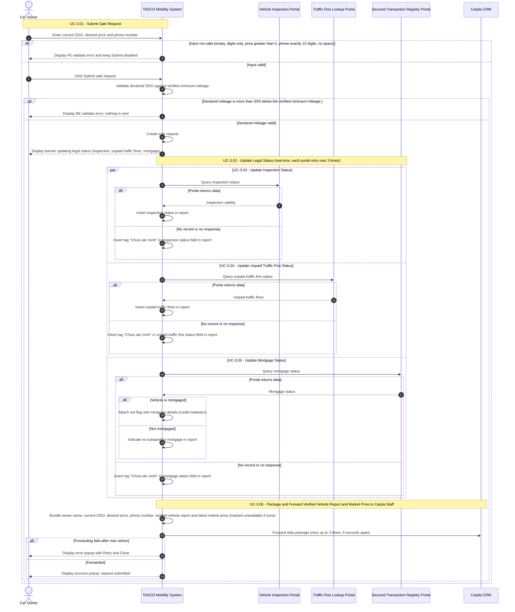

# Sequence Diagram: S-09 Submit Sale Request

| Field | Value |
|---|---|
| Use case |  UC-3.01 Submit Sale Request, UC-3.02 Re-check Legal Status, UC-3.03 Check Inspection Status, UC-3.04 Check Unpaid Traffic Fine Status, UC-3.05 Check Mortgage Status, UC-3.06 Package & Forward Verified Report and Market Price to Carpla Staff |
| Version | v2 |
| FRs | FR-03-01, FR-03-02, FR-03-03 |

