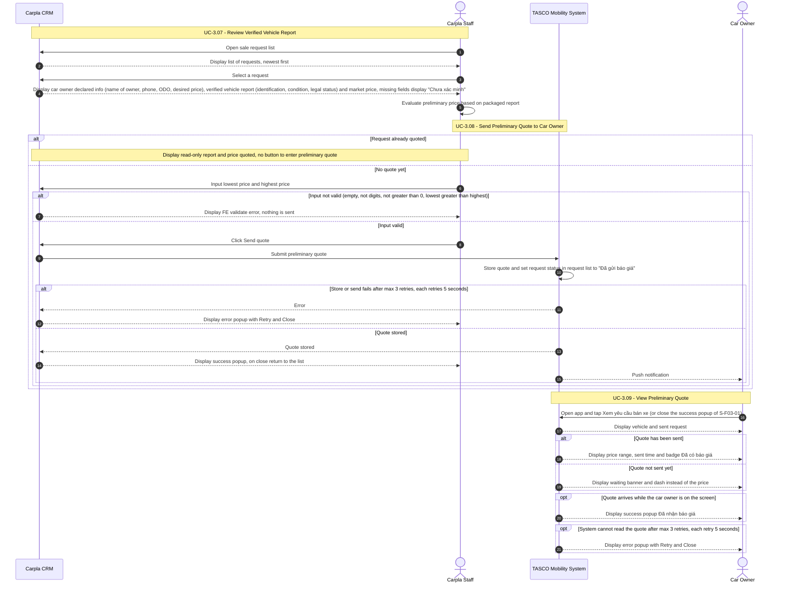

# Sequence Diagram: S-10 Staff Review and Car Owner Preliminary Quote

| Field | Value |
|---|---|
| Use case | UC-3.07 Review Verified Report, UC-3.08 Send Preliminary Quote to Car Owner, UC-3.09 View Preliminary Quote|
| Version | v2 |
| FRs | FR-03-04, FR-03-05, FR-03-06|

